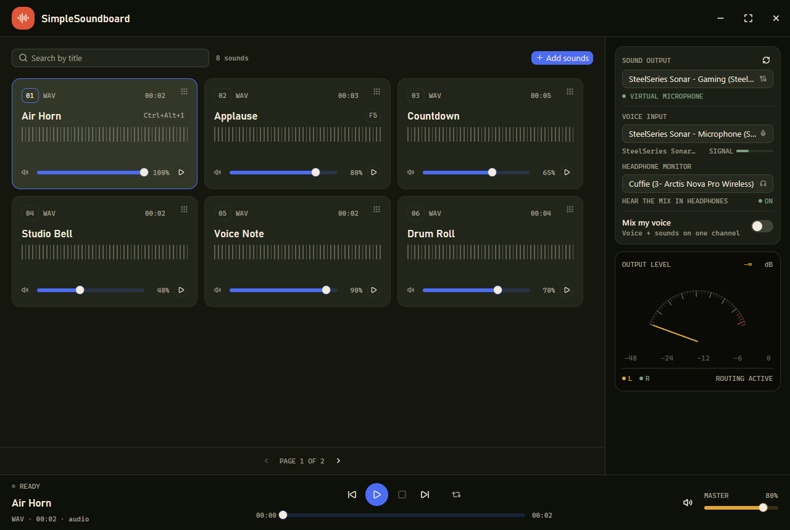
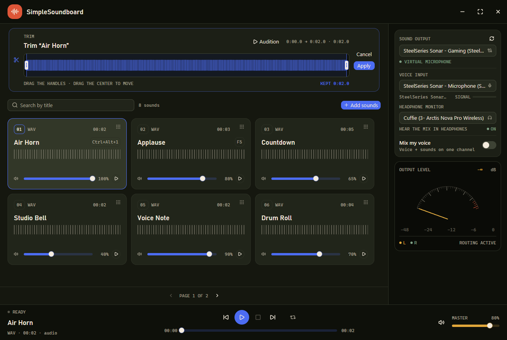

# SimpleSoundboard

A desktop audio console for routing clips and voice into a virtual microphone, built in Rust with **GPUI** and **GPUI Components**.



## What it does

- Imports **MP3, WAV, OGG and FLAC** files from the native picker, by dropping them onto the window, or with `Ctrl+O`.
- After import it opens the trim editor automatically, so you can keep only a portion of the clip. **Audition** plays the selection with a playhead showing the current position.
- Every clip becomes a pad in the bank. **Grab the grid handle** to change the order; right-click for Rename, Trim or Delete. Rename turns the pad title itself into an editable field.
- **Search by title** and page through the bank six pads at a time. The search filters as you type and resets to the first page.
- Assign each pad a **keyboard shortcut**: right-click the pad, choose Set shortcut, then press a Ctrl/Alt combination or an F-key. Shortcuts are checked for conflicts and saved with the bank.
- Plays one clip at a time: a new trigger stops the previous clip, and when the track ends the transport returns to ready. Click a pad that is on air to stop it; click it again to restart.
- Choose the audio output that receives the mix: a virtual cable, an audio interface or a mixer.
- Choose the physical microphone and, with **Mix my voice**, blend the voice into the clips.
- **Headphone monitor**: hear the same mix in headphones even when the main output goes to Discord.
- Shows a two-needle analog VU meter for the output and a signal indicator for the microphone.
- Controls: previous, play/pause, stop, next, loop, seek, master volume and **independent volume per pad**.
- Remembers the bank, names, trims, volumes, devices and monitor in `%APPDATA%\SimpleSoundboard\state.json`. Development builds use a separate profile in `%APPDATA%\SimpleSoundboard-Dev\state.json`.
- Checks for updates on every launch and, when a newer version exists, shows a bottom-right notification with **Update now** and **See changes**.

## Routing to Discord

On Windows an application cannot write directly into the stream of a physical microphone. SimpleSoundboard uses the standard software-console approach: it sends the mix to a **virtual output device**, and the target app reads the opposite side of the same cable as its microphone.

1. Install a virtual audio cable, such as [VB-Audio Virtual Cable](https://vb-audio.com/Cable/), or use an existing virtual device (SteelSeries Sonar, VoiceMeeter and similar).
2. In SimpleSoundboard open **SOUND OUTPUT** and choose the cable's input side, for example `CABLE Input`.
3. In **HEADPHONE MONITOR** choose your headphones. When the output is virtual, the monitor is enabled automatically on a physical device, preferring headphones; select `None` to turn it off.
4. Enable **Mix my voice** if you want the microphone and the clips on the same channel.
5. In the target app — Discord, OBS, Teams, a browser — choose the cable's output side as the microphone, for example `CABLE Output`.

The signal stays on the computer: no file is uploaded to a cloud service.

> Tip: use headphones when the mix includes the microphone to avoid acoustic feedback. The master volume controls both the main output and the monitor.

## Trimming and renaming

When you import a file, the trim editor opens as soon as decoding is ready. The waveform becomes a single interactive surface: the selected portion is highlighted in blue, the rest is dimmed. Drag the two handles to set the start and end, or drag the center of the selection to move it. Press **Audition** to hear the selection: a colored playhead moves across the waveform from the chosen start to the chosen end. Press **Apply** to keep only that portion or **Cancel** to leave the clip intact.

To manage an existing clip, right-click its pad: the context menu offers **Rename**, **Trim** and **Delete**. **Rename** turns the pad title directly into an editable field: **Enter** or the check mark saves, **Esc** or the X cancels. Trimming is applied to the playing sound, its duration and the displayed waveform. Names, order and trims are saved in local state.

To reorder the bank, grab the grid handle in the upper corner of a pad and drag it onto another: the cursor becomes a hand, the ghost follows the pointer, the target pad dims, and the order is saved on release.

To assign a keyboard shortcut, right-click a pad and choose **Set shortcut…**. The pad enters capture mode: press a combination such as `Ctrl+Alt+1` or `F5`. Shortcuts without Ctrl/Alt (except F-keys) and combinations reserved by the app are rejected. Use **Clear shortcut** in the same menu to remove it; the assigned keys appear next to the pad title.

Every pad always shows its volume slider in the bottom row, with the percentage next to it. Drag it to adjust that sound: the change is heard immediately, even while the clip is playing, and is saved. The pad volume is multiplied by the overall **MASTER** volume.



## Updates

On every launch the app queries the latest release published on GitHub. The check runs in the background and never delays or blocks the window: if the network does not respond, the app starts normally.

When a newer version is available, a notification appears in the bottom-right corner with the version number and two actions:

- **Update now**: downloads the Windows setup, verifies that it is a valid executable and launches it silently. The app closes, the setup replaces the files and then reopens the new version.
- **See changes**: opens the GitHub release page in the browser.

The local profile, sounds and settings in `%APPDATA%\SimpleSoundboard` are not touched by the update.

## Installation

Download the latest `SimpleSoundboard-Setup-X.Y.Z.exe` from the repository's **Releases** page.

The installer is per-user and does not require administrator privileges: it installs to `%LOCALAPPDATA%\Programs\SimpleSoundboard`, creates a Start menu entry and, if you choose it, a desktop shortcut. Uninstalling leaves the data in `%APPDATA%\SimpleSoundboard` in place.

> The setup is not code-signed: on first launch Windows SmartScreen may ask for confirmation. Code signing can be added to the workflow when a certificate is available.

## Running

Prerequisites: Windows 10/11, a recent stable Rust toolchain (tested with 1.97.1) and an audio device.

```powershell
# Development build: uses the isolated SimpleSoundboard-Dev profile
cargo run

# Official build: uses the SimpleSoundboard profile of the installation
cargo run --release
```

The development build also shows a **DEV** badge in the title bar, so it is immediately clear which profile is in use. To create an executable:

```powershell
cargo build --release
# target\release\simple-soundboard.exe
```

The app uses these crates:

- `gpui-kit` 0.9 — GPUI, GPUI Base, GPUI Components and Lucide icons.
- `cpal` 0.18 — WASAPI output and input streams, including the separate monitor output.
- `symphonia` 0.6 — MP3/WAV/OGG/FLAC decoding.
- `rfd` — native file picker.
- `ureq` — GitHub release check and setup download.
- `serde`/`serde_json` — local state and GitHub response parsing.

## Commands

| Command | Shortcut |
| --- | --- |
| Play / pause the selected sound | `Ctrl+P` |
| Stop everything | `Esc` |
| Open the file picker | `Ctrl+O` |
| Focus the search field | `Ctrl+F` |
| Loop the current clip | `Ctrl+L` |

Transport commands are available from the buttons with mouse and keyboard. The window controls are drawn by the app; dragging the window uses the top bar.

## Audio details

- The mixer works internally in 32-bit float and resamples linearly to the output sample rate.
- The headphone monitor is a second output stream that inherits the ready mix: no double playback and no double track advance.
- The monitor buffer is about 40 ms; the microphone is buffered for about 30 ms.
- The VU meter is drawn with GPUI's vector canvas.
- Output and monitor are selected by name. If a device is no longer available, the app falls back to the default or disables the monitor.
- A new clip stops all previous voices: the sound on air is always the last one triggered.
- The end of a clip always resets the transport, even when the last block comes from a WAV with a different sample rate than the output.

## Development

```powershell
cargo fmt
cargo test
cargo clippy --all-targets
```

The 22 tests cover WAV and MP3 decoding, mixing, pause, loop, end of voice (including WAV files at a different sample rate), trigger exclusivity, audio trimming, the monitor buffer, device preferences, virtual device detection, version comparison, setup asset selection and keyboard shortcut validation.

Main structure:

```
src/main.rs        GPUI bootstrap, theme, keybindings, window
src/theme.rs       palette and theme tokens
src/model.rs       bank model, trims and formatting
src/audio.rs       cpal, symphonia, mixer and headphone monitor
src/app.rs         app state, persistence, actions
src/app/view.rs    layout, custom title bar, pad wall, routing, transport and update toast
src/update.rs      GitHub release, setup download and launch
installer/         Inno Setup script for the Windows setup
.github/workflows/release.yml  build and publish the release on vX.Y.Z tags
```

## Release

Releases are automated: [`.github/workflows/release.yml`](.github/workflows/release.yml) runs when a tag in the `vX.Y.Z` format is pushed. It builds the app, creates the Inno setup and publishes the GitHub release with generated notes and the `SimpleSoundboard-Setup-X.Y.Z.exe` asset.

Before tagging, the `version` in `Cargo.toml` must match the tag: the workflow refuses to publish if they differ.

```powershell
# Cargo.toml: version = "1.0.0"
git add .
git commit -m "Release v1.0.0"
git tag v1.0.0
git push origin main --tags
```

To build the setup locally, install [Inno Setup 6](https://jrsoftware.org/isinfo.php):

```powershell
cargo build --release
& 'C:\Program Files (x86)\Inno Setup 6\ISCC.exe' installer\simple-soundboard.iss /DAppVersion=1.0.0
# dist\SimpleSoundboard-Setup-1.0.0.exe
```

## Limitations

- Routing to an external app requires a virtual audio device installed on the system.
- The headphone monitor requires a second available physical audio output.
- The project is designed and verified on Windows. GPUI is cross-platform, but the file picker and routing instructions are optimized for Windows.
- There is no auto-advance: a clip ends and the transport returns to ready; the next track starts with the next command.
- Files are read from their original path and are not copied into the app folder.

## License

MIT — see [LICENSE](LICENSE).
